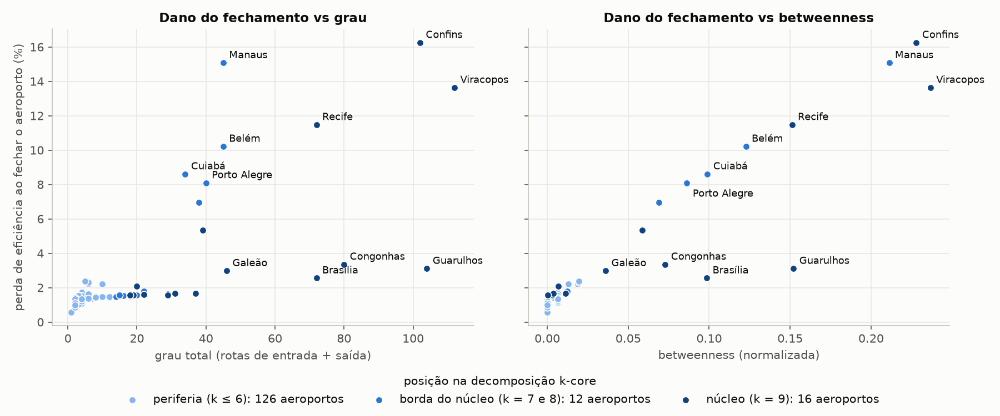
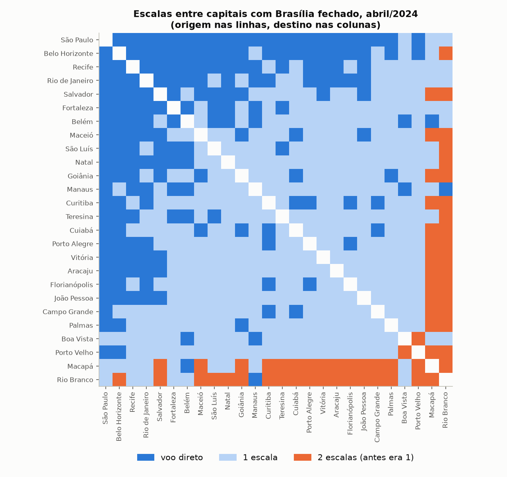
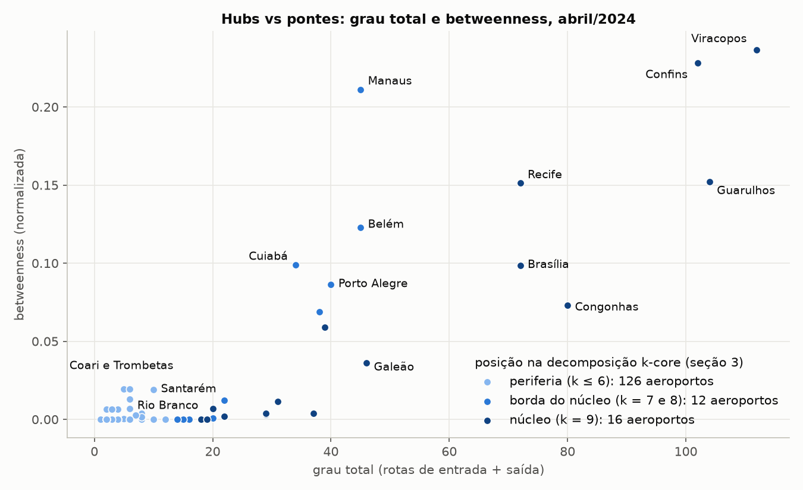
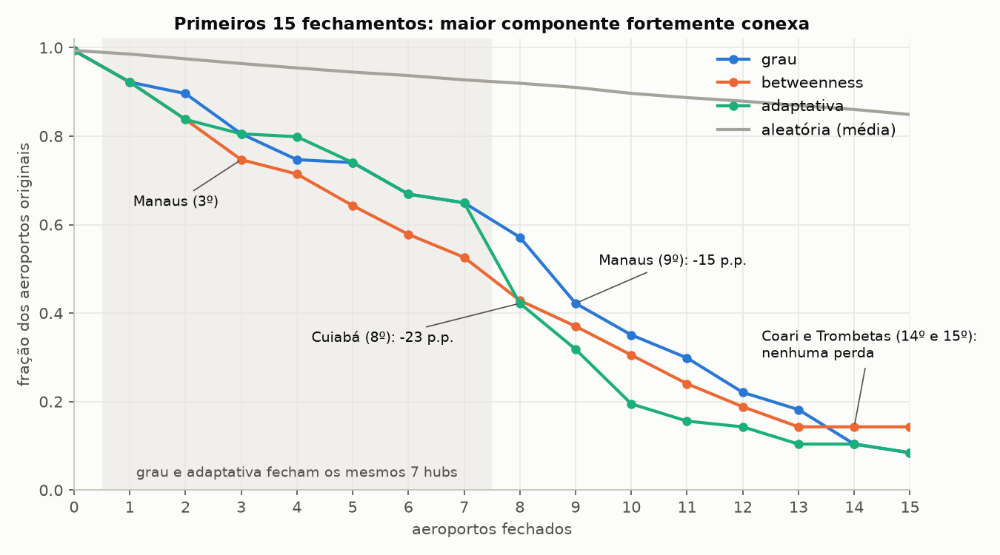
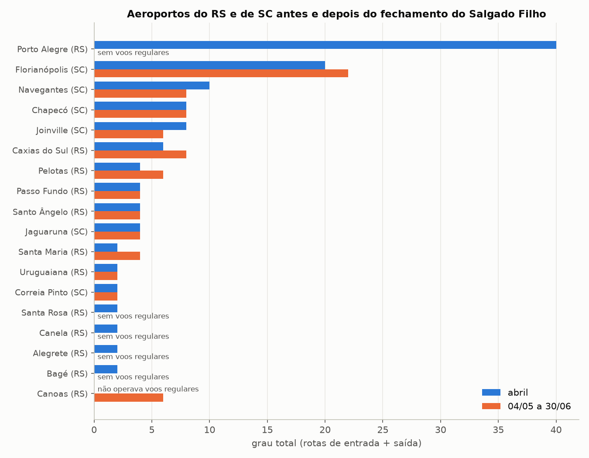

# Estudo da Malha Aérea do Brasil

Projeto da Unidade 1 de Algoritmos e Estrutura de Dados II (DCA/UFRN), prof. Ivanovitch Silva.

Quais aeroportos brasileiros, se fechados, mais desconectam a malha aérea doméstica ou mais aumentam as escalas entre as capitais? Modelamos a malha regular de 2024 como um grafo, simulamos fechamentos e comparamos a simulação com o fechamento real do Aeroporto Salgado Filho (Porto Alegre) nas enchentes de maio de 2024.

## Integrantes
Marcelo dos Santos Vieira · Renan de Aquino Pereira

## Vídeo

## Problema e Pergunta

Fechamentos de aeroportos por eventos climáticos (alagamentos, nevoeiro, tempestades) ou falhas operacionais interrompem a malha aérea e afetam cidades que nem estão próximas do evento. Em maio de 2024, as enchentes no Rio Grande do Sul fecharam o Aeroporto Salgado Filho (Porto Alegre) por meses, um caso real desse tipo de problema.

**Pergunta principal:** quais aeroportos brasileiros, se fechados, mais desconectam a malha doméstica ou mais aumentam o número de escalas entre as capitais? E os aeroportos mais conectados (hubs) são os mesmos que os mais críticos como ponte?

**Hipóteses**

- **H1.** A malha é robusta a falhas aleatórias e frágil a fechamentos direcionados.
- **H2.** Existem aeroportos com betweenness alta e grau baixo ou médio, que funcionam como pontes regionais.
- **H3.** A remoção adaptativa (recalculando a betweenness a cada fechamento) degrada a malha mais rápido que a remoção por grau.
- **H4.** A simulação estática superestima o dano de fechar Porto Alegre, porque não captura a realocação de voos.

Contexto, subperguntas, critérios de refutação de cada hipótese e escopo estão em [`docs/problema.md`](docs/problema.md).

## Dados

- **Fonte:** base VRA (Voo Regular Ativo) da ANAC, dados abertos, um CSV por mês ([portal](https://siros.anac.gov.br/siros/registros/diversos/vra/)). Cada linha é um voo, com origem, destino, empresa, horários previstos e reais, situação (realizado ou cancelado) e tipo de linha.
- **Período:** abril, maio e junho de 2024 (cerca de 80 mil voos por mês, nacionais e internacionais).
- **Filtros:** só voos **realizados**, **domésticos de passageiros** (tipo de linha `N`) e **regulares** (DI `0`, `4` ou `C`, conforme o dicionário da ANAC). Restam **183.029 voos**.
- **Obtenção:** `scripts/baixar_dados.py` baixa os arquivos para `data/raw/` (não versionado). As redes prontas ficam em `data/processed/` (versionado), em GraphML e em CSV de arestas.

Detalhes e justificativas dos filtros: [`docs/modelagem.md`](docs/modelagem.md), seção 2.

## Modelagem

| Elemento | Escolha |
|---|---|
| Nó | aeroporto, pelo código ICAO |
| Aresta | rota de A para B com **pelo menos 1 voo por semana** em média na janela |
| Direção | dirigido (95% das rotas têm volta; medidas como k-core e clustering usam a versão não dirigida) |
| Peso | frequência em voos por semana. **Frequência é força, não distância:** caminhos e escalas são calculados sem peso, por BFS |
| Janelas | **referência:** 01/04 a 30/04/2024; **pós-fechamento:** 04/05 a 30/06/2024 (o último voo regular no Salgado Filho partiu em 03/05) |
| Capitais | as 27 capitais e os aeroportos que as atendem; Rio de Janeiro (Galeão e Santos Dumont) e São Paulo (Guarulhos e Congonhas) usam o menor caminho entre seus aeroportos |
| Fechamento | remoção de um nó e de todas as suas arestas |

A rede de referência tem **154 aeroportos e 816 rotas**; a pós-fechamento, **153 aeroportos e 806 rotas**.

Todas as decisões, a sensibilidade do limiar de frequência e a lista de capitais estão em [`docs/modelagem.md`](docs/modelagem.md).

## Conteúdo do curso utilizado
| conceito | semana | onde apareceu | para que serviu|
| --- | --- | --- | --- |
| Grafo dirigido e ponderado | 2 | `src/rede.py`, `construir_grafo` | modelar rotas com sentido e frequência semanal |
| Densidade | 2 | `src/metricas.py`, `resumo_rede`; `01_descricao_rede.ipynb`, seção 1 | mostrar que só 3,5% dos pares têm voo direto |
| Grau e distribuição de grau | 2 | `src/metricas.py`, `tabela_graus`; `01_descricao_rede.ipynb`, seções 3 e 4 | medir a concentração em poucos hubs e comparar o ranking antes e depois de POA |
| Matriz de adjacência | 2 | `01_descricao_rede.ipynb`, seção 6 | visualizar o bloco denso do núcleo e a periferia ligada a ele |
| Grau de entrada e de saída | 3 | `src/metricas.py`, `tabela_graus`; `01_descricao_rede.ipynb`, seção 2 | verificar que a malha é quase simétrica |
| Componentes (WCC, SCC) | 4 | `src/metricas.py`, `resumo_rede`; `01_descricao_rede.ipynb`, seção 5 | verificar a conectividade e achar aeroportos alcançáveis só em um sentido |
| Caminhos, distâncias e diâmetro | 4 | `src/metricas.py`, `resumo_rede`; `01_descricao_rede.ipynb`, seção 5 | medir a linha de base de escalas antes dos fechamentos |
| Triângulos e clustering | 4 | `src/metricas.py`, `resumo_rede`; `01_descricao_rede.ipynb`, seção 7 | mostrar onde há caminhos alternativos: clustering alto nos aeroportos médios e baixo nos hubs |
| BFS | 3 | `src/metricas.py`, `escalas_bfs_origem` e `escalas_entre_capitais`; `02_hipoteses_e_centralidades.ipynb`, seção 4 | contar escalas de Natal até cada aeroporto e entre todas as capitais |
| Caminhos e distâncias | 4 | `src/metricas.py`, `escalas_entre_capitais`; `02_hipoteses_e_centralidades.ipynb`, seção 4 | mostrar que todas as capitais se ligam com no máximo 1 escala e que Brasília liga todas diretamente |
| Centralidade de betweenness | 4 | `src/metricas.py`, `calcular_centralidades`; `02_hipoteses_e_centralidades.ipynb`, seção 1 | testar H2: identificar pontes (Manaus, Cuiabá e aeroportos amazônicos de grau baixo) |
| Centralidades de closeness e eigenvector | 4 | `src/metricas.py`, `calcular_centralidades`; `02_hipoteses_e_centralidades.ipynb`, seção 2 | mostrar que proximidade e prestígio acompanham o grau, e só a betweenness destaca as pontes |
| Eficiência | 4 | `src/metricas.py`, `eficiencia_global_dirigida`; `02_hipoteses_e_centralidades.ipynb`, seção 5 | registrar a linha de base para as simulações de fechamento |
| k-core, k-shell, core number e degeneracy | 5 | `src/metricas.py`, `analise_kcore`; `02_hipoteses_e_centralidades.ipynb`, seção 3 | confirmar a estrutura núcleo-periferia e mostrar que as pontes ficam na borda do núcleo |
| Componentes (SCC, WCC) sob remoção de nós | 4 | `src/fechamentos.py`, `medir_rede` e `simular_fechamentos`; `03_curvas_fechamento.ipynb`, seções 2 a 4 | medir quanto a malha se desconecta a cada fechamento (H1 e H3) |
| Eficiência sob remoção de nós | 4 | `src/fechamentos.py`, `medir_rede`; `src/metricas.py`, `eficiencia_global_dirigida`; `03_curvas_fechamento.ipynb`, seções 2 e 3 | medir o alongamento dos caminhos a cada fechamento, normalizado pela rede original |
| Grau e betweenness como critério de fechamento | 2 e 4 | `src/fechamentos.py`, `ordem_por_grau`, `ordem_por_betweenness` e `fechamento_adaptativo`; `03_curvas_fechamento.ipynb`, seção 4 | comparar fechamentos direcionados por hubs, por pontes e adaptativos (betweenness recalculada) |
| Componentes (SCC) e eficiência no fechamento de um único aeroporto | 4 | `src/fechamentos.py`, `impacto_individual`; `04_aeroportos_criticos.ipynb`, seções 1 e 2 | responder quais aeroportos mais desconectam a malha (Confins, Manaus, Viracopos, Recife, Belém, Cuiabá, Porto Alegre) |
| BFS, caminhos e distâncias entre capitais com um aeroporto fechado | 3 e 4 | `src/fechamentos.py`, `impacto_individual`; `04_aeroportos_criticos.ipynb`, seções 3 e 5 | responder quais fechamentos mais aumentam escalas entre capitais (Brasília, Galeão, Guarulhos) e o efeito para Natal |
| Grau, betweenness e k-core como preditores de dano | 2, 4 e 5 | `04_aeroportos_criticos.ipynb`, seção 4 | mostrar que hubs redundantes do núcleo causam pouco dano e que a betweenness acompanha melhor o impacto |
| Eficiência e componentes (SCC) sobre uma base comum de aeroportos | 4 | `src/metricas.py`, `eficiencia_entre` e `fracao_na_maior_scc`; `05_poa_simulado_vs_real.ipynb`, seção 2 | comparar de forma justa a simulação do fechamento de POA com a malha real (H4) |
| Subredes e grau | 2 | `05_poa_simulado_vs_real.ipynb`, seções 3 e 4 | mostrar como a sub-rede do RS e de SC se reorganizou (Canoas, Florianópolis, Viracopos) |
| BFS, caminhos e distâncias entre capitais na malha real | 3 e 4 | `src/metricas.py`, `escalas_entre_capitais`; `05_poa_simulado_vs_real.ipynb`, seção 5 | medir a perda de ligações diretas de Porto Alegre com as outras capitais |

## Como executar

Requer Python 3.13 (instalador do [python.org](https://www.python.org/downloads/)).

```bash
# criar e ativar o ambiente virtual
py -3.13 -m venv .venv            # Linux/macOS: python3.13 -m venv .venv
.venv\Scripts\activate            # Linux/macOS: source .venv/bin/activate

# instalar as dependências
pip install -r requirements.txt

# reproduzir tudo: dados, redes, notebooks e figuras (cerca de 2 minutos)
python run_all.py
```

O `run_all.py` executa, em ordem:

1. `scripts/baixar_dados.py`: baixa os dados da VRA de abril a junho de 2024 (cerca de 75 MB, para `data/raw/`). Meses já baixados são pulados; use `python run_all.py --forcar-download` para baixar de novo.
2. `scripts/construir_rede.py`: constrói as redes de referência e pós-fechamento em `data/processed/`.
3. Os notebooks `01` a `05` em `notebooks/`, gravando as saídas neles.
4. Confere se as 11 figuras foram geradas em `figures/`.

Todos os sorteios usam seed fixa, e duas execuções seguidas produzem notebooks e figuras idênticos. As etapas também podem ser rodadas separadamente (`python scripts/baixar_dados.py`, `python scripts/construir_rede.py` e os notebooks no Jupyter).

Se o download falhar com `CERTIFICATE_VERIFY_FAILED`, o Python em uso não encontra os certificados raiz do sistema (acontece, por exemplo, com o Python do MSYS2). Crie o `.venv` com o Python do python.org.

## Resultados

Cada notebook termina com a interpretação completa. Aqui está o resumo.

| Notebook | O que responde |
|---|---|
| [`01_descricao_rede`](notebooks/01_descricao_rede.ipynb) | estrutura geral: densidade, distribuição de grau, componentes, clustering |
| [`02_hipoteses_e_centralidades`](notebooks/02_hipoteses_e_centralidades.ipynb) | H2 (hubs vs pontes), núcleo-periferia (k-core), escalas entre capitais |
| [`03_curvas_fechamento`](notebooks/03_curvas_fechamento.ipynb) | H1 e H3: como a malha se degrada sob fechamentos sucessivos |
| [`04_aeroportos_criticos`](notebooks/04_aeroportos_criticos.ipynb) | **pergunta principal:** o impacto de fechar cada aeroporto sozinho |
| [`05_poa_simulado_vs_real`](notebooks/05_poa_simulado_vs_real.ipynb) | H4: a simulação do fechamento de Porto Alegre contra a malha real |

### Resposta à pergunta principal

**Quem mais desconecta a malha são as portas regionais.** Fechar Confins, Manaus, Viracopos, Recife, Belém, Cuiabá ou Porto Alegre, um de cada vez, tira de 8% a 16% da eficiência da malha e deixa de 6 a 13 aeroportos sem ida e volta com o resto do país. Cada um é o único acesso de uma sub-rede regional: com Manaus fechado, por exemplo, todo o interior do Amazonas fica isolado.

**Quem mais aumenta as escalas entre capitais são três conectores nacionais.** Só 3 dos 154 fechamentos mudam as escalas entre capitais: Brasília (65 pares passam de 1 para 2 escalas, quase todos com Rio Branco ou Macapá), Galeão (26) e Guarulhos (12). **Nenhum fechamento isolado deixa capitais sem caminho entre si**, e na malha intacta todas as capitais se ligam com no máximo 1 escala.

**Hubs e pontes coincidem só em parte.** Guarulhos, Congonhas, Brasília e Galeão estão entre os 7 maiores em grau e quase não desconectam a malha: são hubs redundantes do núcleo. A betweenness acompanha o dano melhor que o grau. E há dois tipos de aeroporto crítico: os que desconectam a periferia não são os mesmos que alongam as viagens entre capitais.





### Hipóteses

| Hipótese | Resultado | Evidência principal |
|---|---|---|
| **H1** robusta a falhas, frágil a fechamentos direcionados | **confirmada** | 8 ou 9 fechamentos direcionados derrubam a maior SCC abaixo de 50%; aleatoriamente, são precisos 54 |
| **H2** pontes regionais com grau baixo | **em parte** | no topo, 9 dos 10 maiores em grau e em betweenness coincidem; abaixo dele, Coari, Trombetas, Santarém e Rio Branco (grau 5 a 10) são pontes amazônicas |
| **H3** adaptativa mais rápida que por grau | **em parte** | nos 7 primeiros fechamentos as duas fecham os mesmos hubs; do 8º em diante a adaptativa fecha Cuiabá (-23 pontos na SCC), Manaus e Belém |
| **H4** simulação superestima o dano de POA | **confirmada** | a simulação previa -6,5% de eficiência e 6 aeroportos desconectados; na malha real foram -4,4% e 4 |

A malha tem estrutura **núcleo-periferia**: um núcleo de 16 aeroportos (k = 9) e uma periferia de 98 aeroportos nos k-shells 1 e 2. As pontes ficam na **borda do núcleo**, não dentro dele.





### Porto Alegre: simulação vs realidade

A simulação acertou **quais** aeroportos dependiam do Salgado Filho, e 4 deles (Bagé, Canela, Alegrete e Santa Rosa) de fato perderam todos os voos regulares. Mas não previu a adaptação: Canoas assumiu as ligações com São Paulo, e parte do interior gaúcho foi religada a Florianópolis, Curitiba e Viracopos. Porto Alegre continuou alcançável, mas passou de voo direto para 7 capitais para só 1 (São Paulo).



## Limitações e próximos passos

**Limitações**

- **Topologia não é demanda.** A rede mede rotas, não passageiros nem assentos. Uma ponte estrutural pode transportar poucas pessoas, e Canoas, com grau 6, tinha muito menos voos que o Salgado Filho.
- **Análise estática.** As simulações não capturam a reorganização das companhias aéreas. O notebook 05 mede esse erro para Porto Alegre: cerca de um terço do dano previsto não aconteceu.
- **Janelas e sazonalidade.** A janela pós-fechamento (maio e junho) também difere de abril por fatores sem relação com Porto Alegre, como aeroportos que entraram ou saíram da malha no Nordeste e no Pará.
- **Conexões terrestres** ficam fora do modelo, e aeroportos próximos (como Canoas e Porto Alegre, ou Navegantes e Florianópolis) se substituem por estrada.
- **Fechamentos em sequência** (notebook 03) servem para medir a estrutura da malha; fechar dezenas de aeroportos ao mesmo tempo não é um cenário realista.

**Próximos passos**

- **Análise de sensibilidade** do limiar de frequência (0,5 e 2 voos por semana) e da agregação dos aeroportos de São Paulo e do Rio de Janeiro, previstas em `docs/modelagem.md` e ainda não feitas.
- **Fechamento regional** (subpergunta 4 de `docs/problema.md`): fechar vários aeroportos vizinhos ao mesmo tempo, como numa tempestade regional.
- **Ponderar por passageiros**, com a base de demanda da ANAC, para medir impacto em pessoas e não só em rotas.
- **Ferramentas complementares** listadas no fim do notebook 01 (CCDF em log-log e comparação com grafos aleatórios).

## Referências

- ALBERT, R.; JEONG, H.; BARABÁSI, A.-L. Error and attack tolerance of complex networks. *Nature*, v. 406, p. 378-382, 2000. Base das estratégias de fechamento aleatório e direcionado (`src/fechamentos.py`).
- AGÊNCIA NACIONAL DE AVIAÇÃO CIVIL (ANAC). Voo Regular Ativo (VRA). Dados abertos. Disponível em: https://siros.anac.gov.br/siros/registros/diversos/vra/.

## Estruturação do repositório

```
malha-aerea-grafo/
├── README.md
├── requirements.txt              # dependências com versões fixadas
├── run_all.py                    # reproduz tudo em um comando
│
├── data/
│   ├── raw/                      # CSVs da VRA (baixados pelo script, não versionados)
│   └── processed/                # redes prontas: .graphml e CSV de arestas
│
├── docs/
│   ├── problema.md               # problema, pergunta, hipóteses e escopo
│   └── modelagem.md              # decisões de modelagem e filtros
│
├── scripts/
│   ├── baixar_dados.py           # baixa a VRA de abril a junho de 2024
│   └── construir_rede.py         # filtra os voos e constrói as redes
│
├── src/                          # funções reutilizáveis (sem gráficos nem caminhos fixos)
│   ├── rede.py                   # leitura da VRA, construção do grafo, capitais
│   ├── metricas.py               # grau, centralidades, k-core, BFS, eficiência
│   └── fechamentos.py            # estratégias de fechamento e impacto individual
│
├── notebooks/
│   ├── 01_descricao_rede.ipynb
│   ├── 02_hipoteses_e_centralidades.ipynb
│   ├── 03_curvas_fechamento.ipynb
│   ├── 04_aeroportos_criticos.ipynb
│   └── 05_poa_simulado_vs_real.ipynb
│
└── figures/                      # 11 figuras, todas geradas pelos notebooks
```

